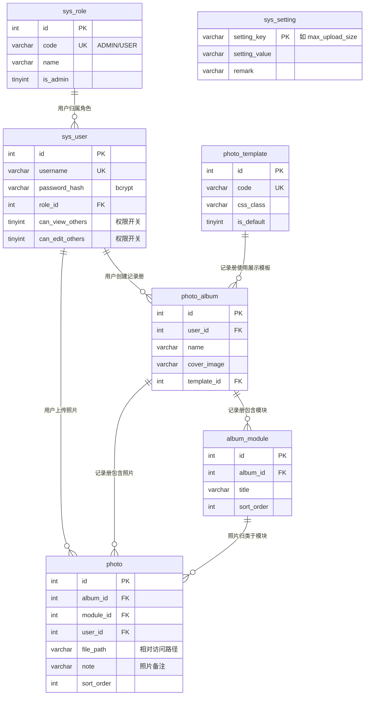

# 数据库设计文档（photo_album / MySQL 8.0，utf8mb4）

## 一、ER 关系说明

关系要点：

| 关系 | 说明 |
| ---- | ---- |
| sys_role 1 → N sys_user | 每个用户归属一个角色；ADMIN 角色拥有全局权限 |
| sys_user 1 → N photo_album | 记录册归属创建人，普通用户默认只能访问自己的记录册（数据隔离） |
| photo_album 1 → N album_module | 一本记录册可自定义多个模块（章节），按 sort_order 排序 |
| photo_album 1 → N photo、album_module 1 → N photo | 照片归属记录册并归类到模块，删除模块时照片自动移入剩余模块 |
| photo_template 1 → N photo_album | 每本记录册绑定一套展示模板，可一键切换整册排版风格 |
| sys_user 1 → N photo | 记录上传人，便于审计 |
| sys_setting（独立键值表） | 管理员可调的运行时配置（当前含上传大小上限 max_upload_size，单位 MB） |

权限模型说明：

- **角色级**：`sys_role.is_admin = 1`（ADMIN）拥有全局权限（查看/编辑所有数据）。
- **用户级开关**：管理员可对普通用户单独开启 `sys_user.can_view_others`（查看他人记录册）与 `sys_user.can_edit_others`（编辑他人记录册）。
- 所有业务查询统一经过 `app/services/permission_service.py` 附加权限条件 / 越权判断。

## 二、表字段说明

所有表统一包含：`id` 主键、`create_time` 创建时间、`update_time` 更新时间、`is_deleted` 软删除标识（0 正常 / 1 已删除）。

### 1. sys_role 角色权限表

| 字段 | 类型 | 说明 |
| ---- | ---- | ---- |
| id | INT PK AI | 主键 |
| code | VARCHAR(32) UK | 角色编码：ADMIN / USER |
| name | VARCHAR(64) | 角色名称 |
| remark | VARCHAR(255) | 角色说明 |
| is_admin | TINYINT(1) | 是否管理员角色 |

### 2. sys_user 用户表

| 字段 | 类型 | 说明 |
| ---- | ---- | ---- |
| id | INT PK AI | 主键 |
| username | VARCHAR(64) UK | 登录账号 |
| password_hash | VARCHAR(128) | bcrypt 密码哈希（禁止明文） |
| nickname | VARCHAR(64) | 昵称（展示用） |
| role_id | INT FK→sys_role.id | 角色 |
| can_view_others | TINYINT(1) | 权限开关：允许查看他人记录册 |
| can_edit_others | TINYINT(1) | 权限开关：允许编辑他人记录册 |
| last_login_time | DATETIME | 最后登录时间 |

### 3. photo_template 模板配置表

| 字段 | 类型 | 说明 |
| ---- | ---- | ---- |
| id | INT PK AI | 主键 |
| code | VARCHAR(32) UK | 模板编码：grid/masonry/polaroid/timeline/compact |
| name | VARCHAR(64) | 模板名称（界面展示） |
| css_class | VARCHAR(64) | 前端 CSS 类名（详情页容器 class） |
| description | VARCHAR(255) | 模板说明 |
| sort_order | INT | 模板下拉排序 |
| is_default | TINYINT(1) | 是否默认模板（新建记录册默认绑定） |

### 4. photo_album 记录册表

| 字段 | 类型 | 说明 |
| ---- | ---- | ---- |
| id | INT PK AI | 主键 |
| user_id | INT FK→sys_user.id | 创建人 |
| name | VARCHAR(100) | 记录册名称 |
| description | VARCHAR(500) | 简介 |
| cover_image | VARCHAR(255) | 封面相对访问路径（默认 /static/img/default_cover.svg） |
| template_id | INT FK→photo_template.id | 当前展示模板 |

### 5. album_module 模块表

| 字段 | 类型 | 说明 |
| ---- | ---- | ---- |
| id | INT PK AI | 主键 |
| album_id | INT FK→photo_album.id | 所属记录册 |
| title | VARCHAR(100) | 模块标题 |
| sort_order | INT | 排序号（越小越靠前，支持拖拽更新） |

### 6. photo 照片表

| 字段 | 类型 | 说明 |
| ---- | ---- | ---- |
| id | INT PK AI | 主键 |
| album_id | INT FK→photo_album.id | 所属记录册 |
| module_id | INT FK→album_module.id | 所属模块 |
| user_id | INT FK→sys_user.id | 上传人 |
| file_path | VARCHAR(255) | 图片相对访问路径（/upload/YYYYMM/uuid.ext） |
| original_name | VARCHAR(255) | 原始文件名 |
| file_size | INT | 文件大小（字节） |
| file_type | VARCHAR(32) | MIME 类型 |
| note | VARCHAR(500) | 照片独立文字备注 |
| sort_order | INT | 模块内排序号（越小越靠前，支持拖拽更新） |

### 7. sys_setting 系统设置表

主键为 `setting_key`（无自增 id）。当前内置键：

| setting_key | 说明 |
| ----------- | ---- |
| max_upload_size | 上传大小上限（MB），范围 1-100，管理员在前端「用户权限」弹窗中调整，即时生效 |

## 三、索引说明

| 表 | 索引 | 类型 | 用途 |
| ---- | ---- | ---- | ---- |
| sys_role | uk_role_code | 唯一 | 角色编码唯一 |
| sys_user | uk_user_username | 唯一 | 登录账号唯一、登录查询 |
| sys_user | ix_user_role | 普通 | 按角色统计/筛选用户 |
| photo_template | uk_template_code | 唯一 | 模板编码唯一 |
| photo_album | ix_album_user_deleted | 组合 | 首页高频查询：按用户取记录册并过滤软删除 |
| photo_album | ix_album_name | 普通 | 名称模糊搜索（LIKE 'xxx%' 可走索引前缀） |
| album_module | ix_module_album_sort | 组合 | 按记录册加载模块并按排序号输出 |
| photo | ix_photo_album_module_sort | 组合 | 详情页核心查询：按记录册+模块加载照片并排序 |
| photo | ix_photo_user | 普通 | 按上传人统计 |

所有表主键自带聚簇索引；外键列均已建立索引，避免关联查询全表扫描。

## 四、存储约定

- **数据库只存图片相对访问路径**（如 `/upload/202611/3f2a….jpg`），物理文件保存在项目 `upload/YYYYMM/` 目录。
- 删除均为**软删除**（is_deleted=1），物理文件保留以便恢复；如需彻底清理可定期按 `photo.is_deleted=1` 的 file_path 清理磁盘文件。
- 建表脚本见 `docs/database.sql`；应用启动时也会自动建表（幂等）。
